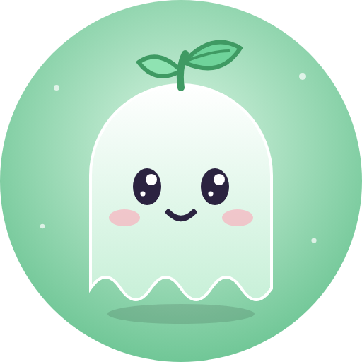

<p align="center"></p>

<h1 align="center">Jade14</h1>
<p align="center"><em>L'opératrice énergique du Ghost Royale : vive, drôle, toujours partante pour un jeu.</em></p>

<p align="center">
  
  
  
  
</p>

## Qui elle est

Jade est la première de la flotte, sur **#montreal** et **#kodi**. Ton vif, orientée jeu :
c'est elle qui lance la chasse au canard et le RPG du canal.

## Ce qu'elle fait

- **GhostBrain** : discute avec l'IA locale (Ollama) en suivant la discussion.
- Chasse au canard, RPG (boss, quêtes, boutique, inventaire), statut du serveur.
- Commandes admin et reconnexion patiente.

## Commandes

| Commande | Effet |
|---|---|
| `jade …` / `!jade <texte>` | Lui parler |
| `!duckhunt` · `!shoot` · `!score` | Chasse au canard |
| `!status` · `!hello` · `!ping` | Les classiques |
| `!join` · `!part` · `!say` · `!addadmin` · `!admins` · `!resetduck` | Admin |

## Structure

| Chemin | Rôle |
|---|---|
| `jade14.py` | Point d'entrée, connexion IRC |
| `config.json` | Serveur, nick, canaux |
| `core/` | GhostBrain, client Ollama, personas |
| `modules/` | Commandes, admin, chasse au canard, reconnexion |
| `rpg/` | Données du RPG |
| `personalities/jade14.txt` | Sa personnalité |
| `legacy/` | Vieux scripts gardés pour mémoire |

## Lancer

```bash
python3 -m venv venv && venv/bin/pip install -r requirements.txt
venv/bin/python3 jade14.py
```

## Secrets

Les mots de passe (X, canaux) et les clés API vont dans un fichier `.env` sur le serveur, **jamais** dans le dépôt. Les bases de données, logs et sauvegardes sont ignorés par git.

---

<p align="center">Fait partie de la flotte <a href="https://github.com/pierrealexandredumouchel-creator"><b>Ghost Royale</b></a> : Jade · Christine · Anya · Tanya · Millie 👻</p>
